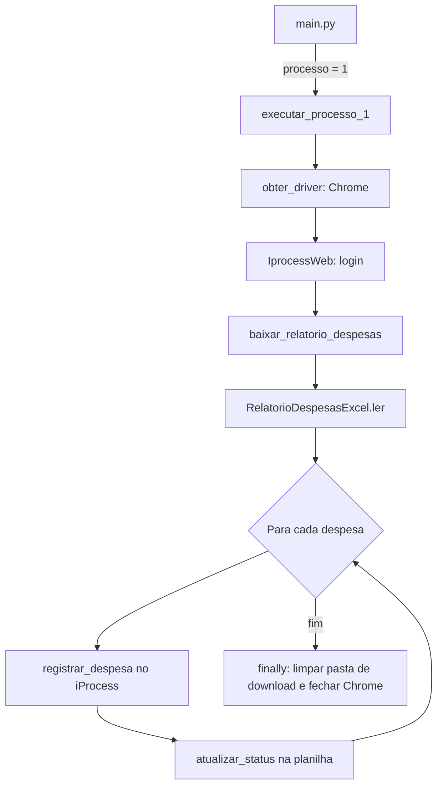

# RPA Exemplo – Registro de Despesas no iProcess

Automação (RPA) em Python que baixa o relatório de despesas (`expenses.xlsx`) do portal **iProcess Web** (ambiente de treinamento), registra cada despesa no sistema via navegador e grava o status de cada registro de volta na própria planilha.

## Sumário

- [Stack](#stack)
- [Arquitetura](#arquitetura)
- [Regras de negócio](#regras-de-negócio)
- [Configuração](#configuração)
- [Como executar](#como-executar)
- [Pontos de atenção](#pontos-de-atenção)

## Stack

| Tecnologia | Uso |
|---|---|
| Python 3.13 | Linguagem (`.python-version`, `requires-python`) |
| uv | Gerenciamento de dependências (`pyproject.toml`, `uv.lock`) |
| Selenium | Automação do navegador Chrome |
| pandas + openpyxl | Leitura e escrita do Excel |
| pydantic | Validação e conversão dos dados (schemas) |
| PyYAML | Leitura das configurações do processo |
| python-dotenv | Carregamento do `.env` |
| loguru | Logs |

## Arquitetura

### Estrutura de diretórios

```
rpa-exemplo/
├── main.py                              # Ponto de entrada: escolhe o processo a executar
├── resources/
│   └── configs/
│       └── processo_1.yaml.example      # Modelo das configurações do processo 1
└── src/
    ├── common/                          # Código compartilhado entre processos
    │   ├── configs/                     # Parâmetros de execução (.env)
    │   ├── schemas/                     # Schemas comuns (credenciais)
    │   └── utils/                       # Driver Chrome, YAML, limpeza de pasta, espera de arquivo, exceções
    └── processes/
        └── process_1/                   # Processo 1: registro de despesas
            ├── processo.py              # Orquestração do processo
            ├── apps/                    # Automação da aplicação web (iprocess_web.py)
            ├── configs/                 # Parâmetros estáticos (processo_1.yaml)
            ├── files/                   # Leitura/escrita do relatório Excel
            ├── schemas/                 # Modelo de uma despesa (DespesaSchema)
            └── tasks/                   # Regra de negócio: registrar_despesas
```

### Camadas e responsabilidades

| Camada | Arquivo(s) | Responsabilidade |
|---|---|---|
| Entrada | `main.py` | Lê `processo` do ambiente e despacha para o processo correspondente (`match/case`). |
| Orquestração | `processo_1/processo.py` | Cria o driver, faz login, baixa o relatório, lê as despesas, executa a tarefa e faz a limpeza final. |
| Regra de negócio | `processo_1/tasks/registrar_despesas.py` | Percorre as despesas, registra cada uma e atualiza o status na planilha. |
| Aplicação web | `processo_1/apps/iprocess_web.py` | Autenticação, download do relatório e preenchimento do formulário de despesas. |
| Arquivos | `processo_1/files/relatorio_despesas_excel.py` | Converte o Excel em `DespesaSchema` e reescreve linhas com o status. |
| Schemas | `processo_1/schemas/`, `common/schemas/` | Validação e conversão de dados com pydantic. |
| Configuração | `common/configs/`, `processo_1/configs/` | Lê variáveis de ambiente (`.env`) e o YAML do processo. |
| Utilitários | `common/utils/` | `obter_driver`, `ler_yaml`, `limpar_pasta`, `aguardar_arquivo_criado`, `RegraNegocioError`. |

### Fluxo de execução



### Convenções do código

- Um pacote por processo (`src/processes/process_N/`), com `__init__.py` expondo os itens via `__all__`.
- Nomes de classes, métodos e mensagens em português.
- Métodos de automação e de arquivos encapsulam erros e relançam com contexto: `Erro ... | <erro original>`.
- Atributos privados com dupla underscore (`self.__driver`) nas classes de integração.
- Logs com `loguru` em cada etapa relevante.

## Regras de negócio

### Seleção do processo

- O processo é definido pela variável `processo`. Hoje só existe o valor `"1"`.
- Qualquer outro valor interrompe a execução com a mensagem "Processo ... não mapeado".

### Credenciais

- `login_iprocess_web` e `senha_iprocess_web` são obrigatórios e não podem ser vazios.

### Download do relatório

- O sistema acessa o relatório **Expenses Report** e clica em **Download Expenses Report**.
- O arquivo esperado é `expenses.xlsx`, salvo em `diretorio_download`.
- O processo aguarda até **60 segundos** pelo arquivo. Se não aparecer, a execução é interrompida com erro.

### Leitura e validação das despesas

Todas as colunas são lidas como texto e cada linha é convertida em uma despesa, validada conforme a tabela abaixo.

| Coluna no Excel | Campo | Tipo | Obrigatório | Regras |
|---|---|---|---|---|
| `Id` | `id` | texto | Sim | Não pode ser vazio. |
| `Date` | `data` | data | Não | Aceita `YYYY-MM-DD HH:MM:SS` ou `DD/MM/YYYY`. Vazio vira `None`. |
| `Requester` | `solicitante` | texto | Sim | Não pode ser vazio. |
| `Category` | `categoria` | texto | Sim | Não pode ser vazio. Deve existir na lista de categorias do portal. |
| `Value` | `valor` | decimal | Não definido na validação | Convertido para `Decimal`. |
| `Description` | `descricao` | texto | Não | Vazio vira `None`. |
| `Status` | `status` | texto | Não | Vazio vira `None`. É preenchido pelo processo. |

### Registro de cada despesa

Para cada despesa, o sistema:

1. Abre o formulário **Register Expense**.
2. Preenche Id, Date, Requester, Value e Description.
3. Seleciona a Category pelo texto visível da opção.
4. Se a Description estiver vazia, usa o texto padrão **"Nenhuma descrição fornecida"**.
5. Clica em **Register**.
6. Lê a mensagem de retorno da tela:
   - Se contiver **"Despesa cadastrada com sucesso!"**, o status é `OK`.
   - Caso contrário, o status é `Erro ao registrar despesa | <mensagem da tela>`.

### Tratamento de erros

- **Erro em uma despesa:** o status da linha recebe `Erro inesperado | <detalhe>` e o processamento segue para a próxima despesa. Um erro isolado não interrompe o lote.
- **Erro global** (login, download ou leitura do Excel): o processo é interrompido com a mensagem "Erro crítico e inesperado ao executar o processo 1".

### Atualização da planilha

- Após cada despesa, a linha com o mesmo `Id` (comparado sem espaços nas extremidades) é reescrita com os dados atuais da despesa, incluindo o `Status`.
- Se a coluna `Id` não existir, ou o `Id` não for encontrado, a atualização falha.

### Encerramento

- Ao final, **toda** a pasta `diretorio_download` é limpa, de forma recursiva. Isso inclui o `expenses.xlsx` com os status gravados.
- O navegador Chrome é fechado.

## Configuração

### Variáveis de ambiente (`.env`)

Copie `.env.example` para `.env` e preencha:

| Variável | Obrigatória | Descrição |
|---|---|---|
| `processo` | Sim | Processo a executar. Atualmente: `1`. |
| `login_iprocess_web` | Sim | Usuário do iProcess Web. |
| `senha_iprocess_web` | Sim | Senha do iProcess Web. |
| `smtp_servidor` | Sim | Endereço do servidor SMTP usado para enviar o e-mail. |
| `smtp_porta` | Não | Porta do servidor SMTP. Usa STARTTLS. Padrão: `587`. |
| `login_smtp` | Sim | Usuário SMTP. Também é o remetente do e-mail. |
| `senha_smtp` | Sim | Senha do usuário SMTP. |
| `headless` | Não | `true` executa o Chrome sem interface. Padrão: `false`. |
| `ambiente_prd` | Não | Hoje não é utilizada pelo código. Padrão: `false`. |

Valores booleanos são lidos como texto: use `true` ou `false`.

### Configurações do processo 1 (`resources/configs/processo_1.yaml`)

Copie `processo_1.yaml.example` para `processo_1.yaml` e preencha:

| Chave | Descrição |
|---|---|
| `diretorio_download` | Pasta onde o relatório é baixado. Será criada se não existir. |
| `destinatarios_email` | Lista de e-mails que recebem o relatório ao final do processo. |

## Como executar

Pré-requisitos:

- Python 3.13
- [uv](https://docs.astral.sh/uv/)
- Google Chrome instalado (o Selenium gerencia o driver)

Passos:

```bash
# 1. Instalar as dependências
uv sync

# 2. Criar os arquivos de configuração a partir dos exemplos
copy .env.example .env
copy resources\configs\processo_1.yaml.example resources\configs\processo_1.yaml

# 3. Preencher .env e processo_1.yaml e executar
uv run main.py
```

## Pontos de atenção

Itens observados no código atual:

- `ambiente_prd` é lido, mas não é usado.
- `RegraNegocioError` é importada na tarefa de registro, mas nenhuma regra a lança. Erros de negócio hoje são tratados como erros genéricos.
- A limpeza final apaga o relatório com os status gravados. O resultado do processamento não fica salvo ao final da execução.
- O caminho do YAML é relativo e usa separador Windows (`resources\configs\processo_1.yaml`). Ele só funciona se o processo for executado a partir da raiz do projeto.
- Se `obter_driver` falhar, a variável `driver` não é criada e o `finally` não consegue fechá-la. A falha é suprimida pelo `suppress`.
- O projeto não possui testes automatizados.
