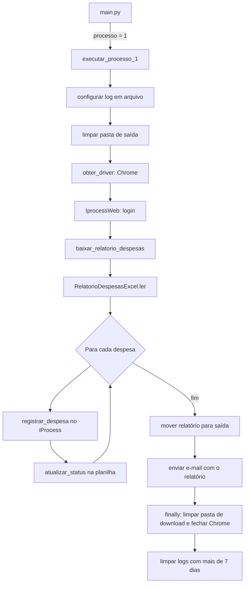

# Processo 1 – Registro de despesas no iProcess Web

Baixa o relatório de despesas (`expenses.xlsx`) do portal iProcess Web (ambiente de treinamento), registra cada despesa no sistema via navegador, grava o status de cada registro na própria planilha e envia o relatório por e-mail.

Visão geral do repositório: [README principal](../../../README.md).

## Sumário

- [Arquitetura](#arquitetura)
- [Fluxo de execução](#fluxo-de-execução)
- [Regras de negócio](#regras-de-negócio)
- [Configuração](#configuração)
- [Como executar](#como-executar)
- [Pontos de atenção](#pontos-de-atenção)

## Arquitetura

| Camada | Arquivo | Responsabilidade |
|---|---|---|
| Orquestração | [processo.py](processo.py) | `executar_processo_1`: configura o log em arquivo, cria o driver, faz login, baixa o relatório, lê as despesas, executa a tarefa, move o relatório, envia o e-mail e faz a limpeza final (inclusive dos logs). |
| Regra de negócio | [tasks/registrar_despesas.py](tasks/registrar_despesas.py) | Percorre as despesas, registra cada uma e atualiza o status na planilha. |
| Aplicação web | [apps/iprocess_web.py](apps/iprocess_web.py) | `IprocessWeb`: autenticação, download do relatório e preenchimento do formulário de despesas. |
| Arquivos | [files/relatorio_despesas_excel.py](files/relatorio_despesas_excel.py) | `RelatorioDespesasExcel`: converte o Excel em `DespesaSchema` e reescreve linhas com o status. |
| Schemas | [schemas/despesa_schema.py](schemas/despesa_schema.py) | `DespesaSchema`: validação e conversão de uma despesa. |
| Configuração | [configs/](configs/) | `ParametrosEstaticosProcesso` (YAML) e `ParametrosExecucaoProcesso` (`.env`). |

## Fluxo de execução



## Regras de negócio

### Credenciais

- `login_iprocess_web` e `senha_iprocess_web` são obrigatórios e não podem ser vazios (`CredenciaisSchema`).

### Download do relatório

- O sistema acessa o relatório **Expenses Report** e clica em **Download Expenses Report**.
- O arquivo esperado é `expenses.xlsx`, salvo em `diretorio_download`.
- O processo aguarda até **60 segundos** pelo arquivo. Se não aparecer, a execução é interrompida com erro.

### Leitura e validação das despesas

Todas as colunas são lidas como texto e cada linha é convertida em `DespesaSchema`.

| Coluna no Excel | Campo | Tipo | Obrigatório | Regras |
|---|---|---|---|---|
| `Id` | `id` | texto | Sim | Não pode ser vazio. |
| `Date` | `data` | data | Não | Aceita `YYYY-MM-DD HH:MM:SS` (se contém `-`) ou `DD/MM/YYYY`. Vazio vira `None`. |
| `Requester` | `solicitante` | texto | Sim | Não pode ser vazio. |
| `Category` | `categoria` | texto | Sim | Não pode ser vazio. Deve corresponder ao texto de uma opção da lista de categorias do portal. |
| `Value` | `valor` | decimal | Sim | Convertido para `Decimal`; valor vazio ou não numérico falha a validação. |
| `Description` | `descricao` | texto | Não | Vazio vira `None`. |
| `Status` | `status` | texto | Não | Vazio vira `None`. É preenchido pelo processo. |

Se qualquer linha for inválida, a leitura falha e o processo é interrompido (nenhuma despesa é registrada).

### Registro de cada despesa

1. Abre o formulário **Register Expense**.
2. Preenche Id, Date, Requester, Value e Description.
3. Seleciona a Category pelo texto visível da opção.
4. Se a Description estiver vazia, usa o texto padrão **"Nenhuma descrição fornecida"**.
5. Clica em **Register**.
6. Lê a mensagem de retorno da tela:
   - Se contiver **"Despesa cadastrada com sucesso!"**, o status é `OK`.
   - Caso contrário, o status é `Erro ao registrar despesa | <mensagem da tela>`.

### Tratamento de erros

- **Erro em uma despesa:** o status da linha recebe `Erro inesperado | <detalhe>` e o processamento segue para a próxima despesa.
- **Erro global** (login, download ou leitura do Excel): o processo é interrompido com "Erro crítico e inesperado ao executar o processo 1".

### Atualização da planilha

- Após cada despesa, a linha com o mesmo `Id` (comparado sem espaços nas extremidades) é reescrita com os dados atuais da despesa, incluindo o `Status`.
- Se a coluna `Id` não existir, ou o `Id` não for encontrado, a atualização falha.

### Encerramento

- No início, `diretorio_saida` é limpa de forma recursiva.
- Ao final do registro, o `expenses.xlsx` com os status é movido para `diretorio_saida` e enviado por e-mail aos `destinatarios_email` (se `enviar_email` for `true`). Assunto: "Processo 1 - Relatório de despesas".
- No `finally`, `diretorio_download` é limpa de forma recursiva e o Chrome é fechado.
- Em seguida, os arquivos de `diretorio_logs` com mais de 7 dias (última modificação) são excluídos de forma recursiva e o arquivo de log do processo é desvinculado. Falha nessa limpeza vira aviso no log e não interrompe o processo.

### Logs

- Além do console, os logs são gravados em `diretorio_logs\processo_1_AAAA-MM-DD.log` (um arquivo por dia, UTF-8).

## Configuração

Variáveis exclusivas do processo (`.env`), em [parametros_execucao_processo.py](configs/parametros_execucao_processo.py):

| Variável | Obrigatória | Descrição |
|---|---|---|
| `login_iprocess_web` | Sim | Usuário do iProcess Web. |
| `senha_iprocess_web` | Sim | Senha do iProcess Web. |

Arquivo `resources/configs/processo_1.yaml` (modelo em [processo_1.yaml.example](../../../resources/configs/processo_1.yaml.example)):

| Chave | Descrição |
|---|---|
| `diretorio_download` | Pasta onde o relatório é baixado. Criada se não existir. É limpa ao final da execução. |
| `diretorio_saida` | Pasta final do relatório. Criada se não existir. É limpa no início da execução. |
| `diretorio_logs` | Pasta dos arquivos de log. Criada se não existir. Arquivos com mais de 7 dias são excluídos ao final da execução. Obrigatória. |
| `destinatarios_email` | Lista de e-mails que recebem o relatório. |

Variáveis compartilhadas (SMTP, `headless`, `enviar_email`): ver [README principal](../../../README.md#configuração).

## Como executar

Defina `processo=1` no `.env` e, a partir da raiz do projeto:

```bash
uv run main.py
```

## Pontos de atenção

- `RegraNegocioError` é importada em [registrar_despesas.py](tasks/registrar_despesas.py), mas nenhuma regra a lança.
- `diretorio_download` só é limpa ao final; um `expenses.xlsx` já existente nela no início satisfaria a espera pelo download.
- Na tarefa de registro, se `atualizar_status` falhar dentro do tratamento de erro de uma despesa, a exceção interrompe o lote inteiro.
- `baixar_relatorio_despesas` está anotada como `-> str`, mas retorna um `Path`.
- Para despesas sem data, o campo Date do formulário recebe o texto `"None"` (`str(despesa.data)`).
- [registrar_despesas.py](tasks/registrar_despesas.py), [iprocess_web.py](apps/iprocess_web.py) (construtor) e [relatorio_despesas_excel.py](files/relatorio_despesas_excel.py) (construtor) não têm docstring em parte das funções.
- O processo não tem testes automatizados.
