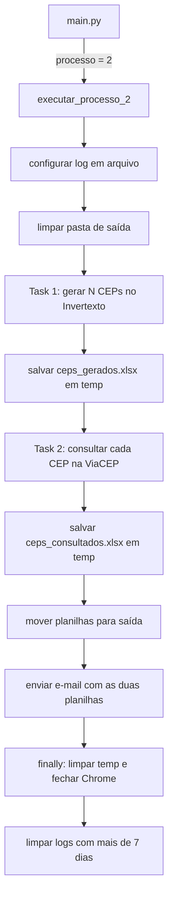

# Processo 2 – Geração e consulta de CEPs

Gera CEPs no site Invertexto, consulta cada CEP na API ViaCEP e envia por e-mail as duas planilhas resultantes (`ceps_gerados.xlsx` e `ceps_consultados.xlsx`).

Visão geral do repositório: [README principal](../../../README.md).

## Sumário

- [Arquitetura](#arquitetura)
- [Fluxo de execução](#fluxo-de-execução)
- [Regras de negócio](#regras-de-negócio)
- [Configuração](#configuração)
- [Como executar](#como-executar)
- [Pontos de atenção](#pontos-de-atenção)

## Arquitetura

| Camada | Arquivo | Responsabilidade |
|---|---|---|
| Orquestração | [processo.py](processo.py) | `executar_processo_2`: configura o log em arquivo, valida a quantidade, limpa a saída, cria o driver, executa as duas tarefas, move as planilhas, envia o e-mail e faz a limpeza final (inclusive dos logs). |
| Regra de negócio | [tasks/gerar_ceps.py](tasks/gerar_ceps.py) | Gera N CEPs e salva `ceps_gerados.xlsx` em `diretorio_temp`. |
| Regra de negócio | [tasks/consultar_ceps.py](tasks/consultar_ceps.py) | Lê os CEPs gerados, consulta cada um e salva `ceps_consultados.xlsx` em `diretorio_temp`. |
| Aplicação web | [apps/invertexto_web.py](apps/invertexto_web.py) | `InvertextoWeb`: Selenium na página `https://www.invertexto.com/gerador-de-cep`. |
| API | [apps/viacep_api.py](apps/viacep_api.py) | `ViaCepApi`: consulta HTTP em `https://viacep.com.br/ws/<cep>/json/`. |
| Arquivos | [files/](files/) | `CepsGeradosExcel` (ler e salvar) e `CepsConsultadosExcel` (salvar). |
| Schemas | [schemas/](schemas/) | `CepGeradoSchema` e `CepConsultadoSchema`. |
| Configuração | [configs/](configs/) | `ParametrosEstaticosProcesso` (YAML) e `ParametrosExecucaoProcesso` (`.env`). |

## Fluxo de execução



## Regras de negócio

### Quantidade de CEPs

- N vem de `quantidade_ceps` (padrão `10`). Se for menor ou igual a zero, o processo falha com "A quantidade de CEPs deve ser maior que zero | <valor>".

### Geração (Invertexto)

- Para cada um dos N CEPs, clica em **gerar** e aguarda (até 10 s) que o campo `cep` mude para um valor não vazio e diferente do anterior.
- Lê os campos `cep`, `endereco`, `bairro`, `cidade` e `uf` da página.
- Uma falha ao gerar um CEP é registrada no log e o lote segue. A planilha contém só os CEPs gerados com sucesso.

`CepGeradoSchema` / colunas de `ceps_gerados.xlsx`:

| Coluna | Campo | Obrigatório | Regras |
|---|---|---|---|
| `CEP` | `cep` | Sim | Não pode ser vazio; espaços nas extremidades são removidos. |
| `Endereço` | `endereco` | Não | |
| `Bairro` | `bairro` | Não | |
| `Cidade` | `cidade` | Não | |
| `UF` | `uf` | Não | |

### Consulta (ViaCEP)

- Os CEPs são lidos de `ceps_gerados.xlsx` (todas as colunas como texto).
- Os caracteres não numéricos do CEP são removidos; se não restarem exatamente 8 dígitos, o status é `CEP inválido | <cep>`.
- A requisição tem timeout de 30 s. Se a resposta trouxer `erro`, o status é `CEP não encontrado na ViaCEP`.
- Caso contrário, os dados retornados são gravados com status `OK`.
- Erro inesperado na consulta (ex.: falha HTTP) gera o status `Erro inesperado | <detalhe>`.
- Um erro isolado não interrompe o lote: a linha é gravada com o `CEP` e o `Status`.

`CepConsultadoSchema` / colunas de `ceps_consultados.xlsx`: `CEP` (obrigatório), `Logradouro`, `Complemento`, `Unidade`, `Bairro`, `Localidade`, `UF`, `Estado`, `Região`, `IBGE`, `GIA`, `DDD`, `SIAFI` e `Status` (todos opcionais).

### Encerramento

- No início, `diretorio_saida` é limpa de forma recursiva.
- As duas planilhas são movidas de `diretorio_temp` para `diretorio_saida` e enviadas por e-mail aos `destinatarios_email` (se `enviar_email` for `true`). Assunto: "Processo 2 - CEPs gerados e consultados".
- No `finally`, `diretorio_temp` é limpa de forma recursiva e o Chrome é fechado.
- Em seguida, os arquivos de `diretorio_logs` com mais de 7 dias (última modificação) são excluídos de forma recursiva e o arquivo de log do processo é desvinculado. Falha nessa limpeza vira aviso no log e não interrompe o processo.
- Erro global: "Erro crítico e inesperado ao executar o processo 2".

### Logs

- Além do console, os logs são gravados em `diretorio_logs\processo_2_AAAA-MM-DD.log` (um arquivo por dia, UTF-8).

## Configuração

Variável exclusiva do processo (`.env`), em [parametros_execucao_processo.py](configs/parametros_execucao_processo.py):

| Variável | Obrigatória | Descrição |
|---|---|---|
| `quantidade_ceps` | Não | Quantidade de CEPs a gerar. Padrão: `10`. Deve ser um inteiro. |

Arquivo `resources/configs/processo_2.yaml` (modelo em [processo_2.yaml.example](../../../resources/configs/processo_2.yaml.example)):

| Chave | Descrição |
|---|---|
| `diretorio_temp` | Pasta onde as planilhas são geradas. É limpa ao final da execução. |
| `diretorio_saida` | Pasta final das planilhas. É limpa no início da execução. |
| `diretorio_logs` | Pasta dos arquivos de log. Criada se não existir. Arquivos com mais de 7 dias são excluídos ao final da execução. Obrigatória. |
| `destinatarios_email` | Lista de e-mails que recebem as duas planilhas. |

Variáveis compartilhadas (SMTP, `headless`, `enviar_email`): ver [README principal](../../../README.md#configuração).

## Como executar

Defina `processo=2` no `.env` e, a partir da raiz do projeto:

```bash
uv run main.py
```

## Pontos de atenção

- Se nenhum CEP for gerado, a planilha de gerados sai vazia, a consulta roda sem itens e o e-mail é enviado com a mensagem de "finalizado com sucesso".
- Um valor não numérico em `quantidade_ceps` falha na importação do módulo de configuração (`int()`).
- O `driver` é criado depois da limpeza da pasta de saída; erros antes disso caem no `finally`, que tenta `driver.quit()` dentro de `suppress`.
- Os métodos de `InvertextoWeb` e `ViaCepApi` funcionam sem tentativas de repetição: cada falha vira erro do item.
- O processo não tem testes automatizados.
